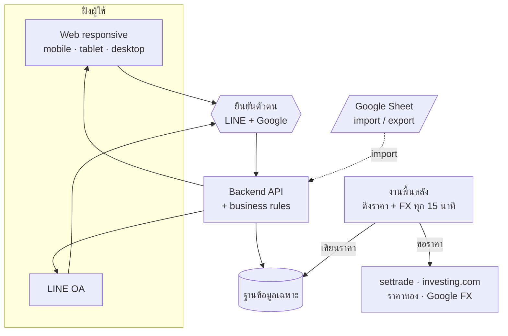
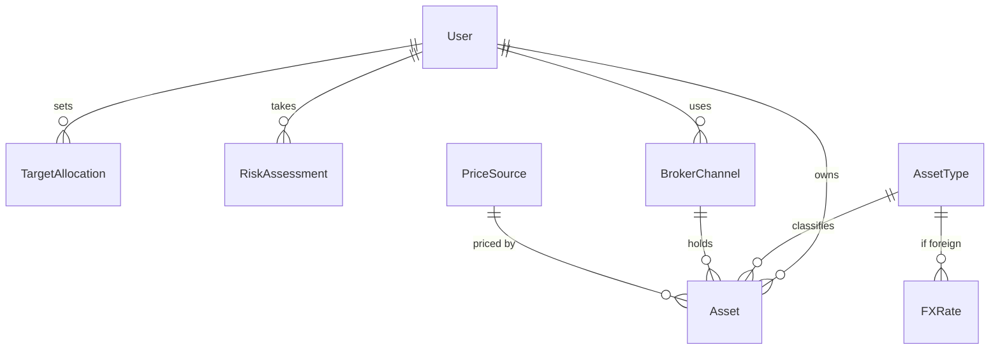

<div align="center">

# 💰 WealthPlaner

### ระบบจัดการ Personal Wealth & Asset Allocation

รวมสินทรัพย์จากทุกพอร์ตการลงทุนไว้ที่เดียว — ทำ asset allocation และติดตาม income/outcome ได้ด้วยตัวเอง<br/>
เหมือนมีทีม personal wealth ส่วนตัว โดยไม่ต้องมีสินทรัพย์ถึงเกณฑ์ 2 ล้าน หรือผูกกับโบรกเดียว

<br/>


</div>

---

## 🎯 ปัญหาที่แก้

> วันนี้ต้องจดราคาต้นทุนและราคาตลาดเองใน Excel รวบรวม **เดือนละครั้ง** ปรับพอร์ตทุก **6 เดือน–1 ปี** — เสียเวลาและเสี่ยงพลาด และเข้าไม่ถึงที่ปรึกษามืออาชีพเพราะถูกล็อกไว้กับผู้มีสินทรัพย์ 2 ล้าน+ ในโบรกเดียว

**เป้าหมาย:** ลดเวลารวบรวม+อัปเดตพอร์ตจาก ~30–60 นาที/เดือน เหลือ **< 10 นาที/เดือน**

---

## ✨ ความสามารถ

| | ฟีเจอร์ | ระดับ |
|---|---|---|
| 📥 | บันทึกสินทรัพย์ข้ามโบรก + ระบุ/แสดง **broker channel** | ต้องมี |
| 📊 | พอร์ตรวม + สัดส่วน **asset allocation** | ต้องมี |
| 🔄 | ดึงราคาตลาดอัตโนมัติ + สถานะ **online/offline** + ปุ่ม refresh | ต้องมี |
| 💹 | คำนวณ **income/outcome** (กำไร/ขาดทุน) | ต้องมี |
| 📗 | นำเข้าข้อมูลเดิมจาก Excel | ควรมี |
| ⚖️ | ส่วนต่าง allocation กับเป้าหมาย (rebalance gap) | ควรมี |
| 🧭 | **แบบประเมินความเสี่ยง** → เสนอ allocation ตัวอย่าง | ควรมี |

<sub>🔒 ราคาถือว่า *stale* เมื่อเก่ากว่า 15 นาที · สินทรัพย์ ตปท. แปลงค่าเงินจาก Google source ทุก 15 นาที</sub>

---

## 🧱 สร้างแล้ว (build) & 🚀 รันเอง

แอป **Next.js 14 (App Router)** รันได้จริง — หน้าจอที่ทำแล้ว:

| หน้า | ฟีเจอร์ | สถานะ |
|---|---|---|
| `/` | พอร์ตรวม + donut asset allocation (F002) | ✅ |
| `/add` | เพิ่มสินทรัพย์ + validation/a11y (F001) | ✅ |
| `/import` | นำเข้า CSV (F005) | ✅ |
| `/rebalance` | ส่วนต่าง allocation กับเป้า (F006) | ✅ |
| `/login` · `/dashboard` | **เข้าสู่ระบบ Google + LINE** (F008) + logout ทุกหน้า | ✅ |
| ราคาตลาดจริง (F003/F004) · แบบประเมินความเสี่ยง (F007) | — | ⏳ Class B |

```bash
# แอปหลัก → http://localhost:3000
cd project/4-build/wealthplaner
npm install
npm run dev            # ต้องมี .env.local (คัดลอกจาก .env.local.example แล้วเติม creds)

# ศูนย์บัญชาการ pipeline แบบ visual → http://127.0.0.1:3300
cd command-center && python3 serve.py
```

🔐 Login ใช้ **Auth.js (NextAuth v5)** — session เป็น JWT ไม่ผูก DB · วิธีตั้งค่า provider (Google/LINE) + ขึ้น production อยู่ใน skill [`sso-login`](.claude/skills/sso-login/SKILL.md)

---

## 🏗️ สถาปัตยกรรม (ไฮบริด · ADR-001)



<sub>เลือกฐานข้อมูลเฉพาะแทน Google Sheet ล้วน เพราะ Sheet ตก NFR-01 (2 วิ) และ NFR-03 (สิทธิ์เฉพาะเจ้าของ) — คง Google Sheet ไว้เป็นสะพาน import/export</sub>

---

## 🗃️ โครงสร้างข้อมูล



---

## 📚 เอกสาร (`project/`)

| เอกสาร | Stage | เนื้อหา |
|---|---|---|
| [`PRD-WPN-001`](project/1-product/PRD-WPN-001.md) | product | Product Requirements — อะไร/ทำไม |
| [`REQ-WPN-001`](project/1-product/REQ-WPN-001.md) | product | ข้อกำหนด + เกณฑ์การยอมรับ (AC 36 ข้อ) |
| [`SRS-WPN-001`](project/2-analysis/SRS-WPN-001.md) | analysis | data model · ADR-001 · behaviour · traceability |
| [`CR-WPN-001`](project/2-analysis/CR-WPN-001.md) | analysis | change request (data storage → ไฮบริด · auth) |
| [`TST-WPN-001`](project/2-analysis/TST-WPN-001.md) | analysis | test cases 43 + traceability matrix |
| [`DSN-WPN-001`](project/3-design/DSN-WPN-001.md) | design | design system — tokens · components ทุก state · screens |
| [`QAR-WPN-001`](project/5-quality/QAR-WPN-001.md) | quality | รายงาน QA — PASS WITH ADVISORIES |

📄 ไฟล์ PDF (ฟอร์แมตส่งมอบ) อยู่ใน [`docs/`](docs/)

---

## 🚦 สถานะ Pipeline

```
intake ─► product ─► analysis ─► design ─► build ─► review ─► release
  ✓        ✓ G1      ✓ G2       ✓ G3     ✓ G4    ✓ G5    ⏳ G6
```

<sub>ตรวจจริงด้วย `/command-center` (verify กับไฟล์จริง · G4 รัน `npm test` + `npm run build` จริง) — หยุดอย่างซื่อสัตย์ที่ G6</sub>

| Gate | ผล | หมายเหตุ |
|---|---|---|
| **G1** · Definition of Ready | ✅ passed | PRD + REQ (AC ครบ, unhappy path ครบ) |
| **G2** · Design handback | ✅ passed | SRS + TST (trace 2 ทาง, AC 36/36) |
| **G3** · Design system ready | ✅ passed | DSN + tokens + components |
| **G4** · Definition of Done | ✅ passed | 33/33 tests + `next build` ผ่าน |
| **G5** · Code review | ✅ passed | review report — ไม่มี blocker |
| **G6** · Ready to release | ⏳ รอ Class B | `release.target` / `approver` / `rollback` ยัง TBD — ต้องให้เจ้าของตัดสิน |

---

## 🔭 สิ่งที่เลื่อน / ยังรอ (Class B)

- ✅ **Stack เลือกแล้ว** — Next.js 14 + TypeScript · **Auth เสร็จแล้ว** — NextAuth v5 (Google + LINE)
- 🗄️ **ฐานข้อมูลจริง** — ตอนนี้ข้อมูลพอร์ตเป็น mock ในหน่วยความจำ (การคงอยู่ข้ามเซสชันรอ DB)
- ⚖️ ตรวจ **ToS/ลิขสิทธิ์** ข้อมูลราคา (settrade · investing.com · Google FX) → ปลดบล็อก F003/F004
- 🤖 **AI ที่ปรึกษา** (REQ-07) · 🧭 แบบประเมินความเสี่ยง (F007) — รอตรวจกรอบ ก.ล.ต.
- 🚀 **ปล่อยจริง (G6)** — รอ `release.target` / `approver` / `rollback` (ซ้อม 1 รอบ)

---

## 🧰 สร้างด้วย

โปรเจ็คนี้เดินผ่าน pipeline ของ [**design-lazyyy-skills**](https://github.com/plugin87/design-lazyyy-skills) —
ชุด Claude Code skills 24 ตัวที่พาโปรเจ็คจากไอเดียสู่ release ผ่าน 6 gate ที่ปฏิเสธได้จริง

<div align="center">
<sub>License: MIT · สร้างจาก template design-lazyyy-skills</sub>
</div>
