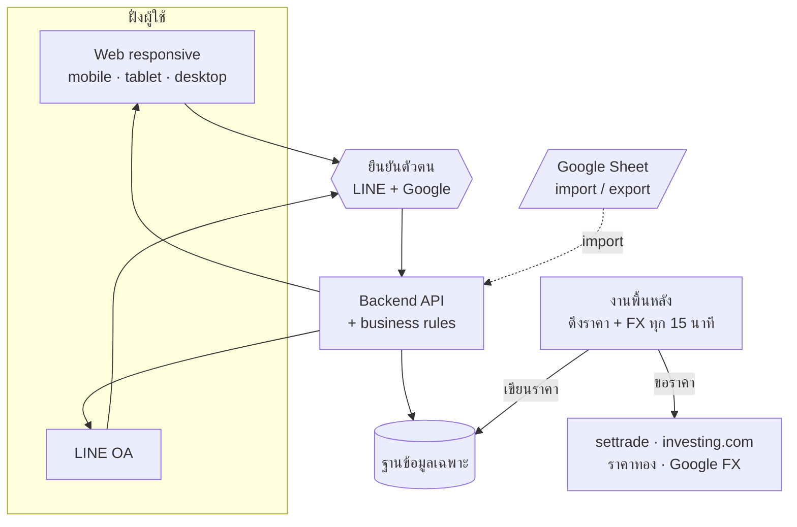
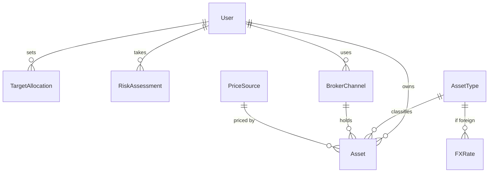

<div align="center">

# 💰 WealthPlaner

### ระบบจัดการ Personal Wealth & Asset Allocation

รวมสินทรัพย์จากทุกพอร์ตการลงทุนไว้ที่เดียว — ทำ asset allocation และติดตาม income/outcome ได้ด้วยตัวเอง<br/>
เหมือนมีทีม personal wealth ส่วนตัว โดยไม่ต้องมีสินทรัพย์ถึงเกณฑ์ 2 ล้าน หรือผูกกับโบรกเดียว

<br/>


</div>

---

## 🎯 ปัญหาที่แก้

> วันนี้ต้องจดราคาต้นทุนและราคาตลาดเองใน Excel รวบรวม **เดือนละครั้ง** ปรับพอร์ตทุก **6 เดือน–1 ปี** — เสียเวลาและเสี่ยงพลาด และเข้าไม่ถึงที่ปรึกษามืออาชีพเพราะถูกล็อกไว้กับผู้มีสินทรัพย์ 2 ล้าน+ ในโบรกเดียว

**เป้าหมาย:** ลดเวลารวบรวม+อัปเดตพอร์ตจาก ~30–60 นาที/เดือน เหลือ **< 10 นาที/เดือน**

---

## ✨ ความสามารถ

| | ฟีเจอร์ | ระดับ |
|---|---|---|
| 📥 | บันทึกสินทรัพย์ข้ามโบรก + ระบุ/แสดง **broker channel** | ต้องมี |
| 📊 | พอร์ตรวม + สัดส่วน **asset allocation** | ต้องมี |
| 🔄 | ดึงราคาตลาดอัตโนมัติ + สถานะ **online/offline** + ปุ่ม refresh | ต้องมี |
| 💹 | คำนวณ **income/outcome** (กำไร/ขาดทุน) | ต้องมี |
| 📗 | นำเข้าข้อมูลเดิมจาก Excel | ควรมี |
| ⚖️ | ส่วนต่าง allocation กับเป้าหมาย (rebalance gap) | ควรมี |
| 🧭 | **แบบประเมินความเสี่ยง** → เสนอ allocation ตัวอย่าง | ควรมี |

<sub>🔒 ราคาถือว่า *stale* เมื่อเก่ากว่า 15 นาที · สินทรัพย์ ตปท. แปลงค่าเงินจาก Google source ทุก 15 นาที</sub>

---

## 🏗️ สถาปัตยกรรม (ไฮบริด · ADR-001)



<sub>เลือกฐานข้อมูลเฉพาะแทน Google Sheet ล้วน เพราะ Sheet ตก NFR-01 (2 วิ) และ NFR-03 (สิทธิ์เฉพาะเจ้าของ) — คง Google Sheet ไว้เป็นสะพาน import/export</sub>

---

## 🗃️ โครงสร้างข้อมูล



---

## 📚 เอกสาร (`project/`)

| เอกสาร | Stage | เนื้อหา |
|---|---|---|
| [`PRD-WPN-001`](project/1-product/PRD-WPN-001.md) | product | Product Requirements — อะไร/ทำไม |
| [`REQ-WPN-001`](project/1-product/REQ-WPN-001.md) | product | ข้อกำหนด + เกณฑ์การยอมรับ (AC 36 ข้อ) |
| [`SRS-WPN-001`](project/2-analysis/SRS-WPN-001.md) | analysis | data model · ADR-001 · behaviour · traceability |
| [`CR-WPN-001`](project/2-analysis/CR-WPN-001.md) | analysis | change request (data storage → ไฮบริด · auth) |
| [`TST-WPN-001`](project/2-analysis/TST-WPN-001.md) | analysis | test cases 43 + traceability matrix |

📄 ไฟล์ PDF (ฟอร์แมตส่งมอบ) อยู่ใน [`docs/`](docs/)

---

## 🚦 สถานะ Pipeline

```
intake ──► product ──► analysis ──► design ──► build ──► review ──► release
  ✓          ✓ G1        ✓ G2        ▶ ตอนนี้
```

| Gate | ผล | หมายเหตุ |
|---|---|---|
| **G1** · Definition of Ready | ✅ passed | PRD + REQ (AC ครบ, unhappy path ครบ) |
| **G2** · Design handback | ✅ passed | SRS + TST (trace 2 ทาง, AC 36/36) |
| **G3** · Design system ready | ⏳ ถัดไป | DSN + tokens + components |

---

## 🔭 สิ่งที่เลื่อน / ต้องตรวจก่อน build

- 🤖 **AI ที่ปรึกษา** (REQ-07) — เลื่อน รอตรวจกรอบ ก.ล.ต.
- 🚫 ซื้อ/ขายอัตโนมัติ · วางแผนภาษี · เชื่อมต่ออัตโนมัติทุกโบรก — นอกขอบเขตรอบนี้
- ⚖️ ตรวจ **ToS/ลิขสิทธิ์** ข้อมูลราคา (settrade · investing.com · Google FX)
- 🛠️ เลือกตัว **DB + ภาษา/เฟรมเวิร์ก** (stack)

---

## 🧰 สร้างด้วย

โปรเจ็คนี้เดินผ่าน pipeline ของ [**design-lazyyy-skills**](https://github.com/plugin87/design-lazyyy-skills) —
ชุด Claude Code skills 24 ตัวที่พาโปรเจ็คจากไอเดียสู่ release ผ่าน 6 gate ที่ปฏิเสธได้จริง

<div align="center">
<sub>License: MIT · สร้างจาก template design-lazyyy-skills</sub>
</div>
