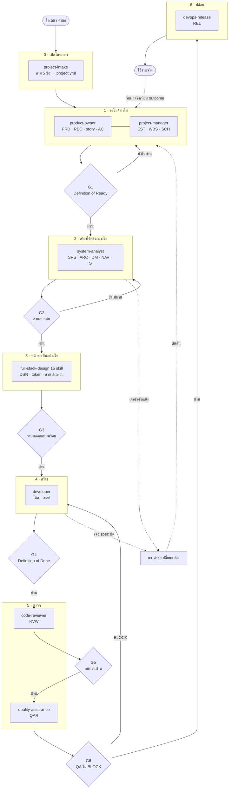

# สายงาน

เอกสารฉบับนี้อธิบายว่า skill ทั้ง 24 ตัวต่อกันเป็นสายเดียวได้อย่างไร
ประตูแต่ละด่านตรวจอะไร และงานส่งต่อกันด้วยอะไร

---

## ภาพรวม



**เส้นประคือส่วนที่คนมองข้ามบ่อยที่สุด** — วงคำขอเปลี่ยนแปลง และการวัดผลจริง
กลับไปเทียบกับตัวเลขที่สัญญาไว้ใน PRD สายงานที่ไม่มีสองเส้นนี้คือสายงานที่
เดินหน้าอย่างเดียวโดยไม่มีใครรู้ว่าถูกหรือเปล่า

---

## บทบาทตอบคำถามคนละคำถาม

| บทบาท | ตอบคำถามว่า | ส่งมอบอะไร | วัดความสำเร็จจาก |
|---|---|---|---|
| `project-intake` | **เรารู้อะไรแล้วบ้าง** | project.yml | ไม่มีใครต้องถามซ้ำ |
| `product-owner` | **ทำอะไร และทำไม** | PRD REQ TRN | ทีมสร้างของที่ถูกต้อง |
| `project-manager` | **อย่างไร และเมื่อไหร่** | EST WBS SCH | ของออกตรงเวลาโดยไม่มีใครตกใจ |
| `system-analyst` | **สร้างได้จริงอย่างไร** | SRS ARC DM NAV TST | นักพัฒนาลงมือได้โดยไม่ต้องเดา |
| `full-stack-design` | **หน้าตาเป็นอย่างไร** | DSN token ส่วนประกอบ | ตรงกันทุกหน้าจอ และทุกคนใช้ได้ |
| `developer` | **สร้างเสร็จหรือยัง** | โค้ด เทสต์ | ตรงกับ spec และรีวิวได้ |
| `code-reviewer` | **โค้ดนี้ควรเข้า repo ไหม** | RVW | คนถัดไปแก้ต่อได้อย่างปลอดภัย |
| `quality-assurance` | **พร้อมส่งมอบหรือยัง** | QAR | ของที่ผ่านไม่ย้อนกลับมาเป็นข้อบกพร่อง |
| `devops-release` | **ปล่อยได้ตอนนี้ไหม** | REL | ปล่อยแล้วถอยกลับได้จริงถ้าต้องถอย |
| `document-control` | **เอกสารฉบับนี้คือฉบับไหน** | ทะเบียน | ไม่มีใครอ่านของเก่าโดยไม่รู้ตัว |

**เส้นแบ่งสั้นที่สุด** — เนื้องาน = PO · เวลาคนความเสี่ยง = PM
· โครงสร้างและข้อมูล = SA · หน้าตา = design · โค้ด = dev
· โค้ดดีไหม = reviewer · ของตรง spec ไหม = QA · ปล่อยได้ไหม = release

---

## ประตูทั้งหกด่าน

รันด้วย `/gate` ซึ่งตรวจของจริงและบันทึกผลลง `project.yml`

| ด่าน | จาก → ไป | คำถามที่ตอบ | เกณฑ์อยู่ที่ไหน |
|---|---|---|---|
| G1 | PO → SA | ข้อกำหนดพร้อมให้ออกแบบหรือยัง | `product-owner` หัวข้อ Definition of Ready |
| G2 | SA → design/dev | แบบสาวกลับหาข้อกำหนดได้ครบไหม | `system-analyst/assets/design-handback-checklist.md` |
| G3 | design → dev | ระบบออกแบบพร้อมให้เขียนโค้ดไหม | `/gate` หัวข้อ G3 |
| G4 | dev → review | งานเสร็จจริงหรือแค่หยุดพิมพ์ | `developer/assets/definition-of-done.md` |
| G5 | review → QA | โค้ดควรเข้า repo ไหม | `code-reviewer` หัวข้อ Merge decision |
| G6 | QA → release | ปล่อยได้ไหม | `devops-release/assets/release-checklist.md` |

**ประตูสองด่านที่คนมักไม่มี** คือ G4 กับ G5 ทั้งที่เป็นด่านที่ราคาถูกที่สุด
และจับปัญหาได้เยอะที่สุด — Definition of Ready มีกันเกือบทุกที่
ส่วน Definition of Done แทบไม่มีใครมี

---

## งานส่งต่อกันด้วยอะไร

**สองทาง** — `project.yml` เป็นความจำร่วม เอกสารเป็นของส่งมอบเป็นทางการ

```
project.yml   ทุกบทบาทอ่านก่อนเริ่ม เขียนกลับเมื่อได้คำตอบใหม่
              → ทำให้ไม่มีใครถูกถามเรื่องเดิมสองครั้ง
              → ทำให้เห็นว่าบทบาทก่อนหน้าทิ้ง TBD ไว้ตรงไหน

เอกสาร        ลงทะเบียนใน REGISTER.md มีรหัส มีเลขฉบับแก้ไข
              → ทำให้รู้ว่ากำลังอ่านฉบับไหน
              → ทำให้รหัสข้อกำหนดสาวกลับได้ตลอดสาย
```

**สายสอบทานย้อนกลับ** คือสิ่งที่ผูกทั้งหมดเข้าด้วยกัน

```
ข้อกำหนด → การออกแบบ → หน้าจอ → กรณีทดสอบ → โค้ด
```

ทุกลูกศรต้องเดินได้ทั้งสองทาง · ชิ้นส่วนที่ไม่มีข้อกำหนดรองรับคือขอบเขตที่งอกเอง
· ข้อกำหนดที่ไม่มีการทดสอบคือความหวัง · โค้ดที่ไม่รู้ว่าทำตามข้อกำหนดข้อไหน
คือโค้ดที่ไม่มีใครกล้าลบ

---

## เมื่ออะไรผิดพลาด

| เกิดอะไร | ทำอะไร | ห้ามทำอะไร |
|---|---|---|
| เอกสารต้นทางขัดกันเอง | `/cr` แล้วทำงานต่อบนสมมติฐานที่ประกาศไว้ | เลือกเองเงียบ ๆ · แก้เอกสารต้นทางเอง |
| ค่าประมาณเปลี่ยนหลังออกแบบ | บอก PM ทันทีที่รู้ | รอใส่ในรายงานฉบับหน้า |
| ประตูไม่ผ่าน | แก้ให้ครบแล้วรัน `/gate` ใหม่ | เลื่อน `stage` เอง |
| QA ตัดสิน BLOCK | ส่งกลับไปที่การพัฒนา | ปล่อยไปก่อนแล้วค่อยแก้ |
| ปล่อยแล้วพัง | กู้บริการก่อน แล้วค่อยหาสาเหตุ | ไล่แก้บนระบบจริงขณะที่ผู้ใช้เดือดร้อน |
| กำหนดการหลุด | วัดช่องว่าง หาสาเหตุ เสนอสามทาง แล้วตั้งฐานใหม่ครั้งเดียว | ตั้งฐานใหม่ทุกสัปดาห์ |

---

## หลักการร่วมของทุก skill

1. **ส่งมอบตัวงาน ไม่ใช่คำอธิบายว่าจะทำงานอย่างไร**
2. **ห้ามแต่งข้อมูลที่ไม่รู้** — ใช้ `TBD — ต้องการ [คน/ข้อมูล]`
3. **ทำสมมติฐานให้เห็น** และระบุว่าตัวเลขไหนเป็นการเดา
4. **ตัดสินใจแทนได้ แต่ต้องบอก** — เขียนหนึ่งบรรทัดท้ายงานให้แย้งได้
5. **รายงานปัญหา ไม่ใช่แก้เงียบ ๆ** — คุณค่าของแต่ละด่านคือจับได้เร็ว
   ไม่ใช่แก้เก่ง
