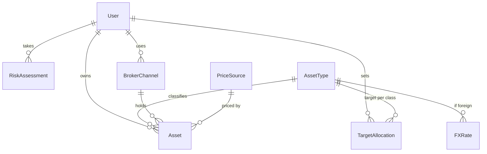
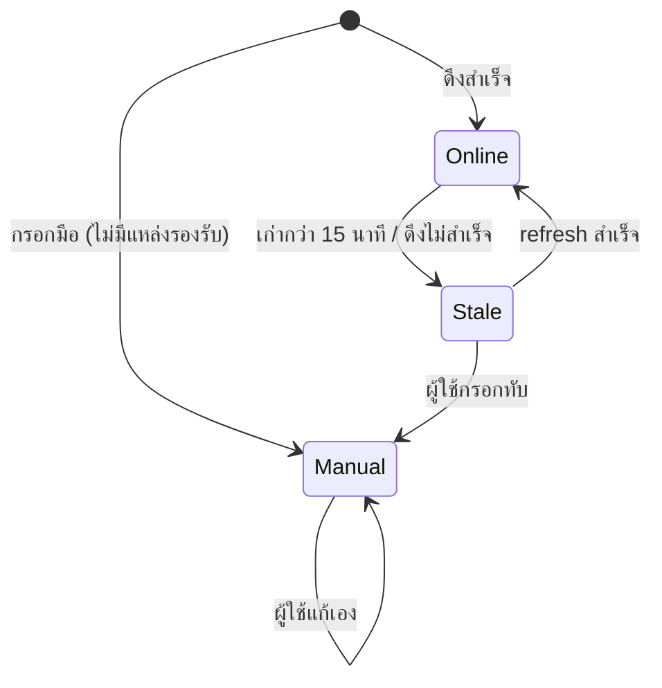

# WealthPlaner — System Requirements and Design Specification

| รายการ | รายละเอียด |
|---|---|
| รหัสเอกสาร | SRS-WPN-001 |
| ฉบับแก้ไขครั้งที่ | 00 |
| วันที่มีผลบังคับใช้ | 2026-08-22 |
| สถานะ | ร่าง |
| เอกสารอ้างอิง | PRD-WPN-001 rev 00 · REQ-WPN-001 rev 00 |
| ผู้จัดทำ | นักวิเคราะห์ระบบ |

---

## 1. Purpose and scope

1.1 เอกสารนี้แปลงข้อกำหนดใน PRD-WPN-001 / REQ-WPN-001 ให้เป็นสิ่งที่ **สร้างได้และตรวจสอบได้** — data model, สถาปัตยกรรม, พฤติกรรมระบบ และการสืบสาว (traceability) สำหรับผู้พัฒนาและ QA

1.2 ไม่ครอบคลุม: การออกแบบภาพ (visual/UI design) — อยู่ใน stage design (DSN) · การจัดลำดับงาน/ตารางเวลา — อยู่ที่ project-manager

1.3 รหัสข้อกำหนดในเอกสารนี้นำมาจาก REQ-WPN-001 โดยไม่เปลี่ยนเลข (F001–F007) หากพบความไม่สอดคล้อง จะรายงานเป็น defect กลับไปที่เอกสารต้นทาง ไม่แก้ในเอกสารนี้

---

## 2. Source material and intake

### 2.1 Documents received

| # | Code | Title | Revision | Date received |
|---|---|---|---|---|
| 1 | PRD-WPN-001 | Product Requirements Document | 00 | 2026-08-22 |
| 2 | REQ-WPN-001 | ข้อกำหนดและเกณฑ์การยอมรับ | 00 | 2026-08-22 |

### 2.2 Decided — designed against

| Ref | Decision | Source |
|---|---|---|
| D1 | broker channel = ระดับบริษัทโบรก (SCBS, KBank) | REQ F001 |
| D2 | ราคา stale เมื่อเก่ากว่า 15 นาที | REQ F003 AC-04 |
| D3 | FX จาก Google source อัปเดตทุก 15 นาที | REQ NFR-04 |
| D4 | budget สมรรถนะ = 2 วินาที (p95) | REQ NFR-01 |
| D5 | แพลตฟอร์ม = web responsive + LINE OA | project.yml technical |
| D6 | REQ-07 (AI ที่ปรึกษา), auto-trade เลื่อน/ตัดออก | PRD scope.out |

### 2.3 Open, not blocking

| Ref | Question | Assumption used | Impact if the assumption is wrong |
|---|---|---|---|
| O1 | ToS ของ settrade/investing.com/Google FX | ออกแบบให้มี fallback กรอกมือ (F003 AC-03) เสมอ | ถ้าแหล่งใดใช้ไม่ได้ → ผู้ใช้กรอกมือมากขึ้น ไม่กระทบ schema |
| O2 | ผู้ใช้รอง (คู่สมรส/ที่ปรึกษา) | ออกแบบ MVP เป็น single-user ต่อบัญชี | ถ้าต้องแชร์พอร์ต → เพิ่ม sharing model ภายหลัง (4.5) |
| O3 | เก็บประวัติราคาย้อนหลังไหม | MVP เก็บ **ราคาล่าสุดเท่านั้น** ไม่เก็บ history | ถ้าต้องการกราฟย้อนหลัง → เพิ่ม entity PriceHistory ภายหลัง |

### 2.4 Open and blocking

| Ref | Question | Blocks | Why it blocks | Owner |
|---|---|---|---|---|
| ~~B1~~ | **ปิดแล้ว 2026-08-22 (CR-WPN-001)** → เลือก Option C ไฮบริด: ฐานข้อมูลเฉพาะ + Google Sheet import | — | — | เจ้าของโครงการ |
| ~~B2~~ | **ปิดแล้ว 2026-08-22 (CR-WPN-001)** → auth = LINE Login + Google (รองรับทั้งสอง) map เข้าสู่ user เดียว | — | — | เจ้าของโครงการ |

### 2.5 Conflicts found in the source material

| # | Requirements in conflict | Nature of the conflict | Impact | Proposed resolution | Status |
|---|---|---|---|---|---|
| C1 | `data_location = Google Sheet/Drive` ↔ NFR-01 (2 วิ p95) + ความจุ + NFR-03 (สิทธิ์เฉพาะเจ้าของ) + การอัปเดตราคาทุก 15 นาที | Google Sheet ไม่ใช่ฐานข้อมูล — ช้าเมื่อข้อมูลโต, บังคับ constraint/ดัชนีไม่ได้, เขียนพร้อมกันมีปัญหา, โมเดลสิทธิ์หยาบ | อาจทำ NFR-01 ไม่ผ่านเมื่อพอร์ตใหญ่ | ยกเป็น **ADR-001** ให้เจ้าของตัดสิน (ไม่เปลี่ยนเงียบ) | รอตัดสิน |
| C2 | `offline = ไม่จำเป็น` (technical) ↔ REQ F003 AC-E02 "แสดงสถานะ offline ทั้งพอร์ต ใช้ค่าล่าสุด" | ดูขัดกัน แต่ที่จริงคือคนละเรื่อง | ต่ำ | นิยามให้ชัด: **ไม่มี offline editing/sync** แต่ต้อง **อ่านค่าล่าสุดแบบ degrade ได้** เมื่อเน็ตหลุด — บันทึกเป็นกฎ BR | เสนอปิด |

> ข้อขัดแย้งรายงานไว้ ไม่ตัดสินฝ่ายเดียว — C1 ต้องแก้เอกสารต้นทาง (revision) หลังเจ้าของตัดสิน ADR-001

---

## 3. Requirement inventory

| ID | Statement | Priority | In this pass | AC count | Notes |
|---|---|---|---|---|---|
| F001 | บันทึกสินทรัพย์ข้ามโบรก + broker channel | ต้องมี | ✅ | 3 + 4E | |
| F002 | แสดงพอร์ตรวม + allocation % | ต้องมี | ✅ | 2 + 2E | |
| F003 | ดึง/อัปเดตราคา + สถานะ online/offline + refresh | ต้องมี | ✅ | 6 + 5E | ขึ้นกับแหล่งภายนอก (O1) |
| F004 | คำนวณ income/outcome | ต้องมี | ✅ | 1 + 2E | ต้องแปลงค่าเงิน (D3) |
| F005 | นำเข้า Excel | ควรมี | ✅ | 1 + 1E | |
| F006 | ส่วนต่าง allocation กับเป้าหมาย | ควรมี | ✅ | 1 + 1E | |
| F007 | แบบประเมินความเสี่ยง + disclaimer | ควรมี | ✅ | 4 + 3E | กรอบ ก.ล.ต. (O ใน REQ) |
| REQ-07 | ผู้ช่วย AI ที่ปรึกษา | — | ❌ deferred | — | ตัด — data model ต้องไม่บล็อก (4.5) |

---

## 4. Data model

### 4.1 Conceptual model

### 4.2 Entity dictionary (conceptual — physical keys รอ ADR-001/B1)

| Entity | Purpose | Key | Attributes สำคัญ | Lifecycle | Traces to |
|---|---|---|---|---|---|
| **User** | เจ้าของพอร์ต | user_id | line_user_id (nullable), google_account_id (nullable), created_at — ต้องมีอย่างน้อย 1 identity | สร้างตอนล็อกอินครั้งแรก (LINE/Google) | ทุก F |
| **BrokerChannel** | บริษัทโบรกที่ถือสินทรัพย์ | broker_id | name (SCBS/KBank/…), user_id | ผู้ใช้เพิ่ม/ลบ | F001 |
| **AssetType** | ประเภท/คลาสสินทรัพย์ (หุ้นไทย/หุ้น ตปท./ทอง/เงินสด/ตราสารหนี้) | type_code | name, is_foreign(bool), price_source_default | อ้างอิง (enum) | F002, F006 |
| **Asset** | สินทรัพย์ที่ถือ 1 รายการ | asset_id | user_id, name, type_code, broker_id, quantity, cost_price, currency, **market_price**, **price_status**(online/offline/manual), **price_updated_at**, price_source_id | ผู้ใช้เพิ่ม/แก้/ลบ | F001–F004 |
| **PriceSource** | แหล่งราคา | source_id | name (settrade/investing/gold/manual), base_url | อ้างอิง | F003 |
| **FXRate** | อัตราแลกเปลี่ยน | (currency, updated_at) | currency, rate_to_thb, source(Google), updated_at | รีเฟรชทุก 15 นาที | F004, NFR-04 |
| **TargetAllocation** | สัดส่วนเป้าหมายต่อคลาส | (user_id, type_code) | target_percent | ผู้ใช้ตั้ง/แก้ | F006 |
| **RiskAssessment** | ผลแบบประเมิน (เก็บประวัติ) | assessment_id | user_id, answers(json), risk_level(1–5), assessed_at, **disclaimer_ack_at** | สร้างใหม่ทุกครั้งที่ทำ | F007 |
| **SchemaMeta** | เวอร์ชัน schema | — | schema_version | migration | 4.4 |

**กฎที่ฝังใน model (ไม่ใช่แค่ UI):**
- `quantity > 0`, `cost_price >= 0` (F001 AC-E02)
- unique(user_id, name, broker_id) → กันบันทึกซ้ำ (F001 AC-E03)
- `TargetAllocation` ต่อ user รวม = 100% จึงจะคำนวณ gap ได้ (F006 AC-E01)
- แยก **definition** (TargetAllocation, RiskAssessment) ออกจาก **execution** (Asset actuals) — แก้เป้าหมายไม่ย้อนแก้ของจริง

### 4.3 Capacity

| Entity | Rows per user | Basis |
|---|---|---|
| Asset | ~50–200 | ประมาณจำนวนสินทรัพย์ที่คนถือ (assumption A1) |
| RiskAssessment | ~2–10 | ประเมินซ้ำเป็นครั้งคราว |
| TargetAllocation | ~5–8 | จำนวนคลาสสินทรัพย์ |
| FXRate | ~5–10 (global, ไม่ต่อ user) | จำนวนสกุลเงิน |

รวมต่อผู้ใช้ ≈ **< 250 rows** (เพราะ MVP เก็บราคาล่าสุด ไม่เก็บ history — O3) → เล็กมาก ทุก store รองรับได้ **ยกเว้น**ปัญหาความเร็ว/สิทธิ์ของ Google Sheet (C1)

### 4.4 Schema versioning and migration

มีฟิลด์ `schema_version` ตั้งแต่ v1 · migration แบบมีลำดับ (v1→v2…) · ถ้า migration ล้ม ต้องไม่เขียนทับข้อมูลเดิม (rollback ได้) · ทดสอบ path v1→v2 อย่างน้อย 1 เส้น

### 4.5 Deferred requirements — extensibility check

| Deferred req | Would it change the schema? | How it stays open |
|---|---|---|
| REQ-07 AI ที่ปรึกษา | ไม่ (อ่านจาก Asset/RiskAssessment ที่มีอยู่) | โมเดลปัจจุบันรองรับการอ่านได้เลย |
| ประวัติราคา (O3) | เพิ่ม entity `PriceHistory(asset_id, price, at)` | ไม่กระทบตารางเดิม |
| แชร์พอร์ต (O2) | เพิ่มตาราง `Share(user_id, asset_scope, role)` | User เป็น key อยู่แล้ว ต่อยอดได้ |

---

## 5. Architecture

### 5.1 Overview

Web responsive (client) → API/บริการ backend → ที่เก็บข้อมูล (**รอ ADR-001**) · งานพื้นหลังดึงราคา/FX ทุก 15 นาที → เขียน market_price + price_updated_at · เข้าถึงผ่าน LINE OA (in-app browser) และเว็บตรง

### 5.2 Decisions

| ADR | Decision | Status |
|---|---|---|
| ADR-001 | ที่เก็บข้อมูล = **Option C ไฮบริด** (ฐานข้อมูลเฉพาะ + Google Sheet import) | **Accepted** 2026-08-22 (CR-WPN-001) |

#### ADR-001 — ที่เก็บข้อมูลของ WealthPlaner

**Context:** เจ้าของระบุ "เก็บบน Google Sheet/Drive" (ต่อยอดจากของเดิม) แต่ NFR-01 (2 วิ), NFR-03 (สิทธิ์เฉพาะเจ้าของ), การอัปเดตราคาทุก 15 นาที และการบังคับ constraint ต้องการที่เก็บที่ทำสิ่งเหล่านี้ได้

**Criteria (จาก NFR):**
| # | Criterion | น้ำหนัก | จาก |
|---|---|---|---|
| 1 | สมรรถนะ query < 2 วิ | สูง | NFR-01 |
| 2 | บังคับ constraint/uniqueness ได้ | สูง | F001 |
| 3 | สิทธิ์เข้าถึงเฉพาะเจ้าของ | สูง | NFR-03 |
| 4 | รองรับเขียนพร้อมกัน (งานดึงราคา + ผู้ใช้) | กลาง | F003 |
| 5 | ทำคนเดียวดูแลไหว/ต้นทุนต่ำ | กลาง | delivery solo |

**Options:**
- **A — Google Sheets เป็นฐานข้อมูล:** อ่าน/เขียนผ่าน Sheets API · *For:* เจ้าของคุ้นเคย ต้นทุน 0 · *Against:* ช้าเมื่อโต, บังคับ constraint ไม่ได้, สิทธิ์หยาบ, rate limit API, เขียนพร้อมกันเสี่ยง — เสี่ยงตก criterion 1–4
- **B — ฐานข้อมูลเฉพาะ (เช่น Postgres/SQLite/Firebase/Supabase):** *For:* ผ่าน 1–4 ครบ, ขยายง่าย · *Against:* ต้องตั้ง/ดูแลเพิ่ม, เจ้าของต้องเรียนรู้
- **C — ไฮบริด:** ผู้ใช้ยังกรอก/นำเข้าผ่าน Google Sheet (F005) แต่ระบบเก็บจริงในฐานข้อมูลเฉพาะ · *For:* คงความคุ้นเคย + ได้สมรรถนะ · *Against:* มี 2 แหล่ง ต้อง sync

**Comparison (สรุป):** A ตก criterion 1–4 · B/C ผ่านทั้งหมด

**Decision:** **Option C (ไฮบริด)** — เก็บจริงในฐานข้อมูลเฉพาะ ใช้ Google Sheet เป็น import/export (F005) deciding criterion = #1 และ #3 ที่ Option A ตกชัด
**Decided by:** **เจ้าของโครงการ 2026-08-22 (Accepted, CR-WPN-001)**

**Consequences:** ได้สมรรถนะ+สิทธิ์ · ต้องตั้งฐานข้อมูล (งานเพิ่ม) · ต้องแก้ `technical.data_location` ใน PRD ผ่าน change request หากเจ้าของเห็นชอบ

### 5.3 Verification against must-have requirements

| Req | How the architecture satisfies it | Verdict |
|---|---|---|
| NFR-01 (2 วิ) | Option C/B ใช้ดัชนีได้ ข้อมูล < 250 rows/user | PASS, unverified (ต้องวัดจริง) |
| NFR-03 (สิทธิ์เฉพาะเจ้าของ) | Option C/B มี auth + row-level access | PASS, unverified (รอ B2) |
| F003 (อัปเดตทุก 15 นาที) | งานพื้นหลังเขียน market_price | PASS, unverified |
| ทั้งหมด บน Option A | ตก NFR-01/03 | FAIL → จึงไม่เลือก A |

### 5.4 Failure behaviour

| Failure | Behaviour | Recoverable |
|---|---|---|
| แหล่งราคาล่ม/timeout | คงสถานะ offline รายตัว แสดงค่าล่าสุด (F003 AC-E01) | ใช่ |
| เน็ตผู้ใช้หลุด | แสดง offline ทั้งพอร์ต ใช้ค่า cache (C2/BR) | ใช่ |
| FX ดึงไม่ได้ | ใช้ค่าล่าสุด + flag เวลา | ใช่ |
| migration ล้ม | ไม่เขียนทับ rollback (4.4) | ใช่ |

---

## 6. Behaviour specification

### 6.1 Business rules

| ID | Rule | Traces to |
|---|---|---|
| BR-01 | ราคาถือว่า stale เมื่อ now − price_updated_at > 15 นาที | F003 AC-04, D2 |
| BR-02 | ไม่มี offline editing/sync — ออฟไลน์ = อ่านค่าล่าสุดเท่านั้น (ปิด C2) | F003 AC-E02 |
| BR-03 | income = (market_price − cost_price) × quantity; ถ้าไม่มี market_price → แสดง "—" ไม่ใช่ 0 | F004 AC-01/E01 |
| BR-04 | %income คำนวณไม่ได้เมื่อ cost_price = 0 (กันหารศูนย์) | F004 AC-E02 |
| BR-05 | สินทรัพย์ต่างประเทศแปลงเป็น THB ด้วย FXRate ล่าสุด | F004, NFR-04 |
| BR-06 | rebalance gap คำนวณเมื่อ TargetAllocation รวม = 100% | F006 AC-E01 |
| BR-07 | ต้องกดรับทราบ disclaimer ก่อนเห็นผลแบบประเมิน (บันทึก disclaimer_ack_at) | F007 AC-04 |

### 6.2 Use cases / 6.3 State models

**สถานะราคาของ Asset:**

| ศัพท์ในภาพ | ความหมาย |
|---|---|
| Online | ราคาสด ภายใน 15 นาที |
| Stale | ราคาเก่ากว่า 15 นาที หรือดึงไม่สำเร็จ (แสดง offline) |
| Manual | ผู้ใช้กรอกเอง |

### 6.4 Screen flow

**STAGED — รอการออกแบบ (stage design)** ระบุสถานะที่ต้องมีต่อหน้าจอไว้แล้วใน REQ (ว่าง/โหลด/error/บางส่วน/offline) นักออกแบบต้องครอบให้ครบ

### 6.5 Error catalogue

| Code | Cause | User sees | System does | Recoverable | Traces to |
|---|---|---|---|---|---|
| E-PRICE-FETCH | ดึงราคาไม่สำเร็จ | "ราคาอาจไม่เป็นปัจจุบัน" + เวลาล่าสุด | คงค่าเดิม สถานะ stale | ใช่ | F003 AC-E01 |
| E-OFFLINE | ไม่มีเน็ต | แบนเนอร์ offline | ใช้ค่า cache | ใช่ | F003 AC-E02 |
| E-PRICE-ANOMALY | ราคาผิดปกติ (0/กระโดด) | flag ให้ตรวจ | ไม่เขียนทับเงียบ | ใช่ | F003 AC-E03 |
| E-REFRESH-OFFLINE | กด refresh ตอนไม่มีเน็ต | "ยังออฟไลน์ ลองใหม่ภายหลัง" | คงค่าเดิม | ใช่ | F003 AC-E05 |
| E-VALIDATION | กรอกไม่ครบ/ค่าผิด | ระบุช่องที่ผิด | ไม่บันทึก | ใช่ | F001 AC-E01/E02 |
| E-DUP | บันทึกซ้ำ | เตือนซ้ำ | ให้ยืนยัน/รวม | ใช่ | F001 AC-E03 |
| E-ALLOC-SUM | เป้ารวมไม่ถึง 100% | เตือน | ไม่คำนวณ gap | ใช่ | F006 AC-E01 |

---

## 7. Interfaces

Contract ของ boundary ภายนอก (settrade / investing.com / Google FX) — request/response/timeout/idempotency **STAGED** รอผล ADR-001 และการตรวจ ToS (O1) จึงจะ finalize · ทุก contract ต้องระบุพฤติกรรม timeout (map → E-PRICE-FETCH)

---

## 8. Non-functional requirements as design constraints

| NFR | Source | Design constraint | How it is verified |
|---|---|---|---|
| NFR-01 | REQ | หน้าพอร์ตรวม < 2 วิ p95 บนมือถือกลาง | โหลดทดสอบด้วยข้อมูลจริง ~200 assets |
| NFR-02 | REQ | WCAG 2.1 AA ทุกหน้าหลัก | เครื่องมือ a11y + คีย์บอร์ด |
| NFR-03 | REQ | สิทธิ์เข้าถึงเฉพาะเจ้าของ ห้าม public | ตรวจ access control (รอ ADR-001/B2) |
| NFR-04 | REQ | FX Google source อัปเดต 15 นาที · THB หลัก | เทียบอัตรากับแหล่ง |
| NFR-05 | REQ | web responsive + LINE OA in-app browser | ทดสอบข้ามอุปกรณ์ + LINE OA |

ไม่มี adjective ตกค้าง — ทุกข้อมีตัวเลข/วิธีวัด หรืออยู่ใน 2.4

---

## 9. Test approach

Test case ทั้งหมดอยู่ใน **TST-WPN-001** (38 cases ครอบ AC 36/36 + NFR/migration) พร้อม traceability matrix อ่านได้ 2 ทาง · เน้น coverage **ตรรกะเวลา** (stale 15 นาที ขอบ 14/16 นาที) และ **การคำนวณ** (income, %, หารศูนย์, FX)

## 10. Revised estimate

| Work package | Prior | Revised | Δ | Reason |
|---|---|---|---|---|
| ทั้งโครงการ | ไม่มี (PM ยังไม่ประเมิน) | TBD | — | รอ ADR-001 เพราะที่เก็บข้อมูลเปลี่ยนขนาดงาน backend มาก |

## 11. Assumptions

| ID | Assumption | Because | If wrong | Owner | By when |
|---|---|---|---|---|---|
| A1 | ~50–200 assets/user | ไม่มีตัวเลขจริง | ปรับ index/สมรรถนะ | เจ้าของ | ก่อน build |
| A2 | MVP single-user ต่อบัญชี | ไม่ระบุการแชร์ | เพิ่ม sharing model (4.5) | เจ้าของ | ก่อน design |
| A3 | เก็บราคาล่าสุด ไม่เก็บ history | ลดความซับซ้อน MVP | เพิ่ม PriceHistory | เจ้าของ | ก่อน design |

## 12. Open questions

| # | Question | Blocks | Owner | Needed by |
|---|---|---|---|---|
| ~~B1~~ | ปิดแล้ว → ไฮบริด (CR-WPN-001) | — | — | — |
| ~~B2~~ | ปิดแล้ว → auth LINE+Google (CR-WPN-001) | — | — | — |
| O1 | ToS แหล่งราคา | interface contract F003/F004 | ผู้รู้กฎหมาย | ก่อน build |
| B3 | เลือกตัว DB + ภาษา/เฟรมเวิร์ก (stack) ของไฮบริด | physical schema, interface | system-analyst/developer | ก่อน build |

## 13. Revision history

| Rev | Date | Sections changed | Substance and reason | Impact on scope, effort, metrics | Author |
|---|---|---|---|---|---|
| 00 | 2026-08-22 | All | First issue — data model, ADR-001, behaviour, traceability | ชี้ว่า ADR-001 อาจเปลี่ยน effort backend | นักวิเคราะห์ระบบ |
